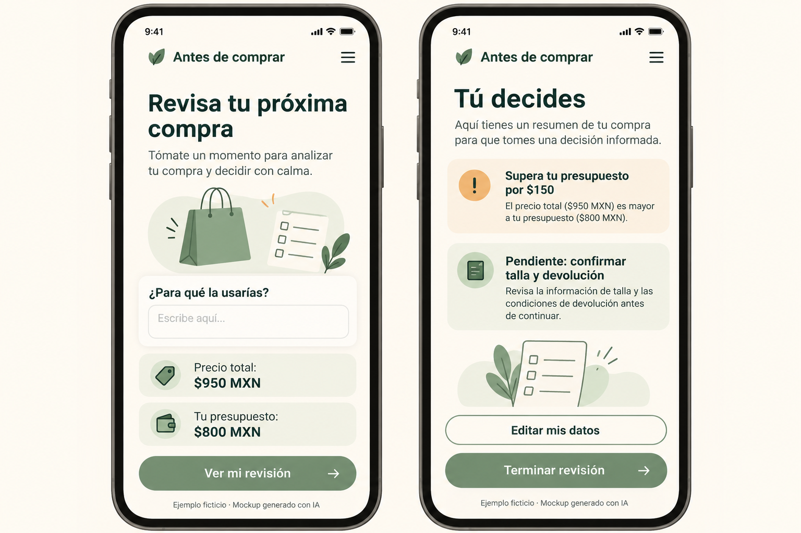
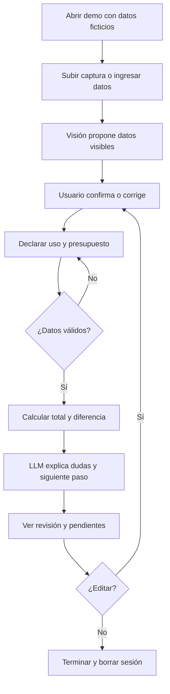
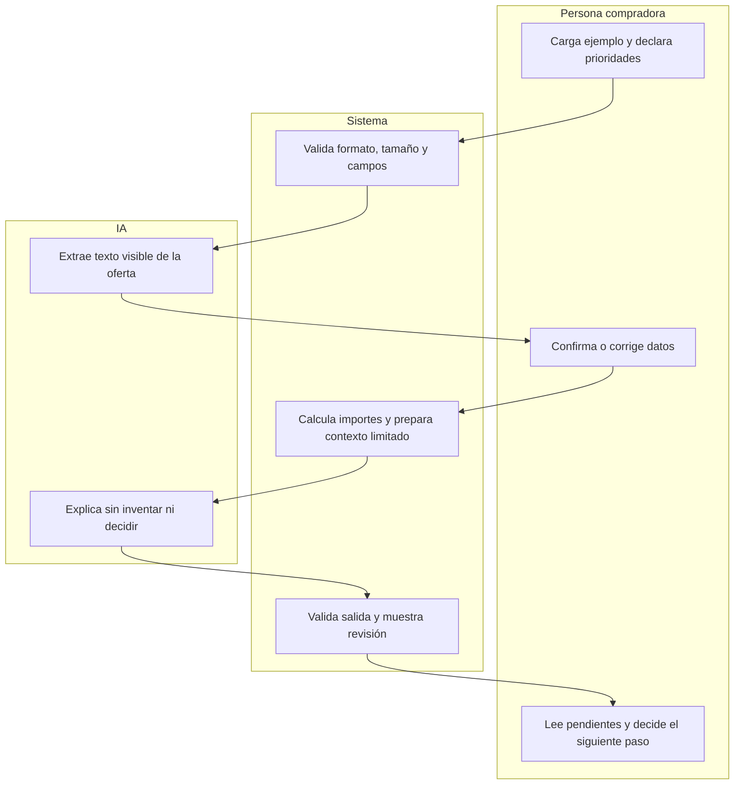

# PACKET · Antes de comprar
**Isabella Zevada · Business Bending · Week 10 · 18 de octubre de 2026**

## 1. Problema en mis palabras
Las tiendas ayudan a vender, pero el comprador no siempre tiene una revisión breve que conecte lo que necesita con el costo total y lo que aún desconoce de la prenda. Quiero ayudarle a aclarar esa decisión antes de pagar, sin imponerle qué comprar. Una devolución no demuestra por sí sola arrepentimiento ni que la personalización haya causado una mala decisión.

## 2. Usuario exacto
Persona adulta de CDMX que está considerando comprar ropa, consulta desde su celular y quiere revisar uso, presupuesto y dudas de talla o devolución. Puede tener poca facilidad con formularios; por eso el lenguaje será sencillo y podrá recibir acompañamiento neutral. Este perfil delimita el primer diseño, no es un hallazgo de investigación ni representa a todos los compradores.

## 3. Éxito antes de cerrar el módulo
Antes de cerrar el módulo funciona en una URL una revisión completa: cargar una captura ficticia de una oferta, confirmar o corregir sus datos, declarar uso y presupuesto, y recibir una explicación breve con diferencia de presupuesto, información desconocida y un siguiente paso. La persona puede editar sus respuestas o terminar sin comprar. La visión y el LLM deben operar realmente; una salida de ejemplo se etiqueta como simulada y no cuenta como integración funcional.

Caso de aceptación: precio confirmado de $950 MXN, envío de $80 y presupuesto de $800 producen un total de $1,030 y una diferencia de $230. Si el envío se desconoce, no se presenta $950 como total final. Si no hay política verificada, el resultado dice «Pendiente de verificar».

## 4. Mockup generado con IA

Dos pantallas: ingreso de datos y revisión. El mockup es una referencia visual; no prueba que el producto esté construido. Los importes del mockup son ficticios. La versión funcional añadirá el campo de envío y la confirmación de datos leídos.

## 5. Flujo de la función

## 6. Responsabilidades · swimlane

La persona acompañante, si participa en la prueba, explica las preguntas sin sugerir respuestas ni productos y confirma que registró las palabras de la persona. No hay un revisor humano conectado dentro de esta demo; no se mostrará una cola ni una promesa ficticia de atención.

## 7. Benchmark global → local
El mejor referente existente que tomo para este problema es **Which?**, por su enfoque en pruebas y orientación al comprador; es una elección de benchmark, no un ranking mundial demostrado. Mi propuesta se diferencia al revisar una prenda que la persona ya considera, usando español, pesos mexicanos, sus límites declarados y dudas locales, sin replicar un laboratorio de productos.

Which? describe pruebas de productos y evaluaciones orientadas al consumidor y publica sus criterios de evaluación. Eso respalda tomar su disciplina de evidencia como referente, no afirmar que nuestro prototipo ofrece pruebas equivalentes.

## 8. Visión a tres años · tres oraciones
Si esta revisión aporta valor, en tres años el producto podría ayudar a compradores de distintas categorías a entender costos, restricciones y condiciones antes de pagar. La información tendría fuentes y fechas visibles, y el acceso acompañado se incluiría en el costo del servicio cuando sea necesario. El crecimiento dependería de utilidad demostrada, independencia frente a vendedores y capacidad de corregir errores sin quitarle la decisión a la persona.

## 9. Condiciones del Blueprint y shadow clause
Base disponible: decisiones documentadas en CHAT_10_IsabellaZevada.pdf. No se ha recibido un Blueprint final independiente; esta tabla traduce esas decisiones a criterios de construcción y deberá cotejarse con ese documento antes de afirmar cumplimiento integral.

| Condición recuperada | Regla de esta versión |
|---|---|
| Trabajar para el comprador | Sin tienda, afiliados, comisiones ni ranking para vendedores. |
| Evitar la «jaula» de optimización | Explicar consecuencias; nunca bloquear, juzgar o cambiar límites. |
| Respetar prioridades declaradas | Se pueden corregir datos, omitir lo opcional y terminar. |
| Hacer visible la incertidumbre | Sin fuente verificada, no afirmar devolución ni asequibilidad. |
| Acompañamiento neutral | Explicar preguntas, registrar palabras y confirmar con la persona. |
| Probar antes de ampliar | No confundir terminar el formulario con recibir ayuda concreta. |

Shadow clause propuesta a partir del debate: si la herramienta o el acompañante empieza a decidir por la persona, presionarla o presentar como segura una condición desconocida, se pausa la respuesta afectada y se corrige antes de continuar. Un error importante incluye generar un gasto innecesario o hacer perder una opción. Esta redacción no sustituye una cláusula final que aún no hemos recibido.

## 10. Recorte de alcance
Construiré una sola revisión de ropa, en español y MXN, con ejemplos ficticios de dos tiendas identificadas como Tienda A y Tienda B. No representaré sus políticas como políticas de comercios reales. Quedan fuera pagos, compras automáticas, gestión de devoluciones, conexión bancaria, clóset, perfiles persistentes, historial, notificaciones, comparación de tiendas y recomendaciones comerciales. Verificar políticas reales de dos tiendas es un paso posterior; mientras tanto la app solo organiza dudas y no determina elegibilidad para devolver.

## 11. Arquitectura y Dragon Stack
Navegador → endpoint de servidor → modelo multimodal → salida estructurada validada → pantalla. El cálculo monetario lo hace código determinista con centavos enteros, no el LLM. La entrada manual permite continuar si falla la lectura, pero no sustituye demostrar la capacidad de visión.

| Capa | Herramienta propuesta | Función y límite |
|---|---|---|
| Interfaz | Next.js, TypeScript y CSS | Formulario móvil y resultados legibles. |
| Restricciones del usuario | Objeto temporal validado | Uso, presupuesto, precio, envío y dudas; sin perfil. |
| LLM | Gemini API con modelo que admita nivel gratuito | Explicación breve basada solo en datos confirmados. |
| Tercera capacidad: visión | Entrada de imagen del modelo multimodal | Leer una captura de oferta; no inferir datos invisibles. |
| Servidor | Endpoint de Next.js | Validación, límites y clave fuera del cliente. |
| Hosting y repo | Vercel Hobby y GitHub | Usar solo disponibilidad gratuita; confirmar cuotas al construir. |
| Pruebas | Vitest y revisión en navegador | Cálculos, validación, fallas de IA y flujo móvil. |

La documentación de Gemini publica un nivel gratuito limitado y señala que el contenido puede usarse para mejorar productos. Esta entrega se limita por ello a datos y capturas inventados; no está autorizada para recibir información personal real. Antes de programar se confirmará un modelo multimodal gratuito disponible en la cuenta y sus límites; si no está disponible, se registrará el bloqueo, sin activar cobros ni presentar respuestas simuladas como integración real.

## 12. Security floor · criterios previos al despliegue
1. Clave solo en variables de entorno de Vercel, nunca en repo, cliente ni capturas; .env.example sin valores y .env ignorado. Revisar archivos y commits antes del push.
2. Demo sin base de datos, cuentas ni historial; datos ficticios únicamente. Mantener estado solo en memoria, no localStorage, cookies, archivos o logs de contenido; borrar al terminar o recargar. El proveedor procesa solicitudes: no prometer que «nada sale del dispositivo».
3. Auth y RLS no aplican a esta versión sin almacenamiento de datos personales ni tablas. Si se añade almacenamiento personal, primero incorporar Supabase Auth con Google, RLS por auth.uid() y pruebas entre dos cuentas; no desplegar esa función antes.
4. Validar en cliente y servidor: texto de uso de 1–300 caracteres, importes finitos no negativos hasta $100,000 MXN, máximo dos decimales, presupuesto mayor a cero; imagen PNG/JPEG de hasta 3 MB y dimensiones máximas de 4096×4096, verificando decodificación y tipo real. Permitir «No sé» para envío, talla y devolución. No ejecutar instrucciones embebidas en imágenes ni texto: son datos no confiables.
5. Etiqueta visible «Demo con datos ficticios» y, cuando corresponda, «Respuesta simulada». No usar recibos ni identidades reales; desactivar analítica y registro de cuerpos de solicitudes. Limitar llamadas por sesión y tamaño; ante cuota agotada, mostrar error claro, sin cambiar a cobro.

La salida del modelo tendrá esquema validado, longitud limitada y texto escapado; no HTML libre, URLs inventadas ni cálculos nuevos. No se descargarán enlaces ingresados por usuarios. Un error de IA no debe borrar los datos confirmados ni fabricar un resultado exitoso.

## 13. Plan de pruebas · todavía no ejecutado
| Caso | Resultado esperado |
|---|---|
| $950 + $80, presupuesto $800 | Total $1,030; excedente $230. |
| Total igual al presupuesto | Diferencia $0; sin juicio de buena compra. |
| Envío desconocido | Total incompleto y costo por confirmar. |
| Imagen borrosa o sin precio | Pedir confirmación; no inventar importe. |
| Visión confunde $950 con $95 | Corregir a $950 antes de calcular. |
| Política o talla desconocida | Lista inmediata de verificación; sin promesa de devolución. |
| Negativo, infinito, texto largo o archivo inválido | Rechazo claro en cliente y servidor. |
| Instrucción maliciosa en imagen | No cambia reglas ni expone configuración. |
| API caída o cuota agotada | Aviso honesto, conserva campos y permite reintentar. |
| Terminar y recargar | Sin contenido persistente ni logs de datos de la consulta. |
| Móvil y teclado | Campos y botones accesibles, sin recortes; foco visible. |

Prueba mecánica: ejecutar la tabla en el primer despliegue, documentar un fallo observado con evidencia, corregirlo, repetir el caso y desplegar una segunda versión. No inventar un bug ni un resultado aprobado; registrar esperado, observado, evidencia, commit y URL del arreglo.

Persona test en chat nuevo: Laura, 54 años, CDMX, usa WhatsApp, lee despacio y desconfía de páginas que piden datos; persona sintética e hipótesis de prueba, no usuaria real entrevistada. Dar capturas ordenadas de inicio, carga/confirmación, preguntas y resultado; pedir que narre qué entiende, dónde duda, qué tocaría y cuándo abandonaría, usando solo lo visible. Registrar cada confusión, corregir la más grave y repetir las pantallas afectadas; no completar PERSONA.pdf con resultados antes de hacer la prueba.

Métrica exploratoria posterior: por cada ruta de entrada, al menos 3 de 5 personas con oportunidad real de compra deben completar la revisión e identificar una ayuda concreta en las mismas tres personas. Separar tiempo, abandonos, acompañamiento, costo de reclutamiento y comprensión; esto habilita otra prueba pequeña, no ampliar a 100 ni afirmar reducción causal del arrepentimiento. La prueba sintética no demuestra este umbral.

## 14. Plan de implementación y evidencia
1. Commit 1: packet, mockup y decisiones iniciales antes del código funcional.
2. Commit 2: formulario, validación y estado temporal.
3. Commit 3: lectura visual, confirmación y manejo de errores.
4. Commit 4: cálculo determinista, explicación del LLM y despliegue 1.
5. Commit 5: arreglo de un bug mecánico documentado y pruebas.
6. Commit 6: arreglo principal de persona, comprobación y despliegue 2.

Los commits y despliegues anteriores son un plan, no hechos realizados. Al cerrar cada sesión: actualizar DECISIONS.md, anotar el primer paso de mañana, commit y push. Guardar la conversación completa real para BUILDCHAT; no reconstruir intervenciones faltantes.

## 15. Entrega y pendientes
Entregar URL, GitHub, DEMO_IsabellaZevada.mp4, PACKET_IsabellaZevada.pdf, PERSONA_IsabellaZevada.pdf y BUILDCHAT_IsabellaZevada.pdf. Demo: tres minutos del recorrido y treinta segundos de qué cambió mi opinión. Este packet no acredita construcción, despliegues ni pruebas realizadas.

Antes de construir: cotejar Blueprint y shadow clause final, confirmar modelo gratuito y entorno, guardar este archivo como docs/PACKET.md en el repo y hacer el primer commit. El siguiente trabajo será convertir este packet en un prompt de implementación con criterios de aceptación.

## Fuentes y trazabilidad
- CHAT_10_IsabellaZevada.pdf, conversación documentada de la semana 10, consultada para este packet: respuestas 33–35, 39–45 y 51–67. Las decisiones no son resultados de un piloto.
- Which?, How we test: https://b2b.which.co.uk/about-us/how-we-test (consulta: 18/10/2026).
- Google AI for Developers, Gemini Developer API pricing: https://ai.google.dev/gemini-api/docs/pricing (consulta: 18/10/2026). Confirmar condiciones al implementar.

Prompt del mockup: dos pantallas móviles de una revisión antes de comprar, español, fondo crema y acentos verdes, uso, precio, presupuesto, excedente, dudas pendientes y opciones para editar o terminar; sin botones de compra ni calificaciones; datos ficticios y etiqueta de imagen generada con IA.
